1. Выборка всех данных из таблицы

1. 1. Получить из таблицы teacher всех старших преподавателей ИТИС с дополнительной информацией о том, относится ли преподаватель к кафедре программной инженерии
```sql
SELECT *, 
       CASE
           WHEN department.nameofdepartment = 'Кафедра программной инженерии' THEN 'Да'
           ELSE 'Нет'
       END AS se
FROM teacher INNER JOIN department ON teacher.departmentname = department.nameofdepartment WHERE department.facultyname = 'ИТИС' AND teacher.post = 'Старший преподаватель';
```
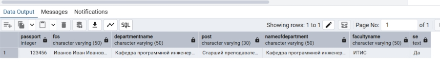

1. 2. Получить все данные о факультетах и связанных с ними кафедрах, включая факультеты, у которых пока нет ни одной кафедры
```sql
SELECT * FROM faculty LEFT JOIN department ON faculty.nameoffaculty = department.facultyname;
```
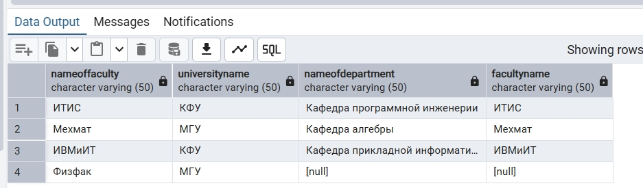

2. Выборка отдельных столбцов

2. 1. Получить названия всех кафедр и ФИО работающих на них преподавателей, включая кафедры, за которыми пока не закреплён ни один преподаватель
```sql
SELECT department.nameofdepartment, teacher.FCs FROM teacher RIGHT JOIN department ON teacher.departmentname = department.nameofdepartment;
```
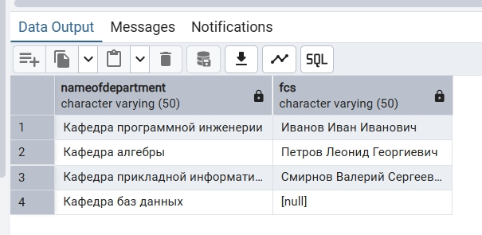

2. 2. Получить ФИО студентов и номера их групп
```sql
SELECT FCs, AcademicGroup FROM student;
```
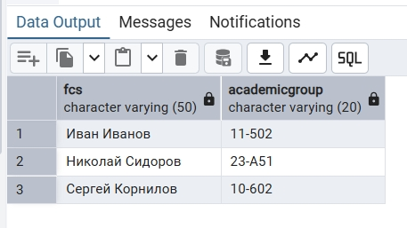

3. Присвоение новых имён столбцам при формировании выборки

3. 1. Получить названия университетов и города, в которых они находятся, на русском
```sql
SELECT NameOfUniversity AS Университет, City AS Город FROM university;
```
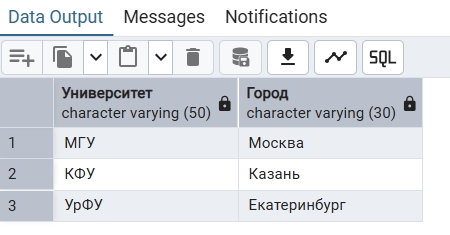

3. 2. Получить названия дисциплин и формы аттестации на русском
```sql
SELECT DisciplineName AS Предмет, CertificationForm AS Форма_аттестации FROM discipline;
```
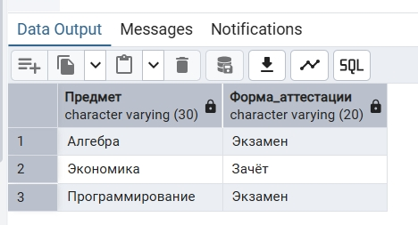

4. Выборка данных с созданием вычисляемого столбца

4. 1. Получить названия дисциплин, их трудоёмкость и трудоёмкость, увеличенную на 10 часов
```sql
SELECT DisciplineName, Intensity, Intensity + 10 AS IncreasedIntensity FROM discipline;
```
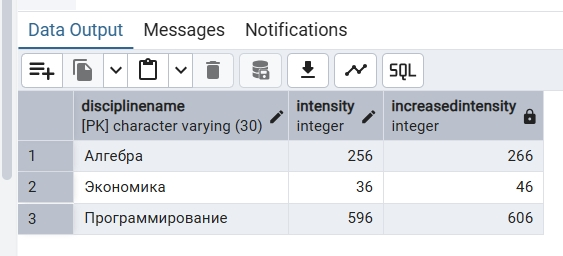

4. 2. Получить группы, их текущие курсы и курсы, на которых они находились в прошлом году
```sql
SELECT Course, numberofgroup, Course - 1 AS previousYear FROM academic_group;
```
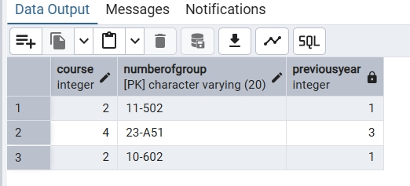

5. Выборка данных, вычисляемые столбцы, математические функции

5. 1. Получить названия дисциплин и количество зачётных единиц при расчёте одной единицы за 36 часов, округлив результат до двух знаков
```sql
SELECT DisciplineName, ROUND(Intensity / 36.0, 2) AS CreditUnits FROM discipline;
```
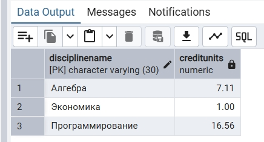

5. 2. Получить названия дисциплин и модуль разности между их трудоёмкостью и 100 часами
```sql
SELECT DisciplineName, ABS(Intensity - 100) AS DifferenceFrom100 FROM discipline;
```
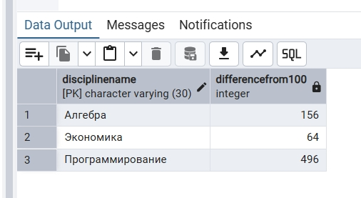

6. Выборка данных, вычисляемые столбцы, логические функции

6. 1. Получить номера групп и определить, относятся они к младшим или старшим курсам
```sql
SELECT NumberOfGroup, Course,
       CASE
           WHEN Course <= 2 THEN 'Младший курс'
           ELSE 'Старший курс'
       END AS CourseType
FROM academic_group;
```
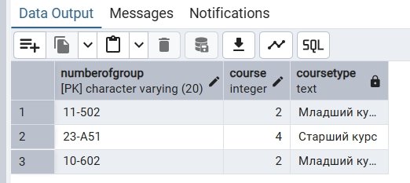

6. 2. Получить названия дисциплин и определить, проводится ли по ним экзамен
```sql
SELECT DisciplineName,
       CASE
           WHEN CertificationForm = 'Экзамен' THEN 'С экзаменом'
           ELSE 'Без экзамена'
       END AS ExamStatus
FROM discipline;
```
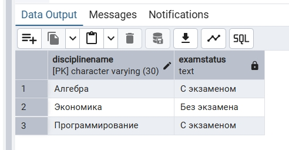

7. Выборка данных по условию

7. 1. Получить дисциплины с трудоёмкостью более 100 часов
```sql
SELECT * FROM discipline WHERE Intensity > 100;
```
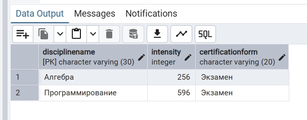

7. 2. Получить студентов группы 11-502
```sql
SELECT * FROM student WHERE AcademicGroup = '11-502';
```
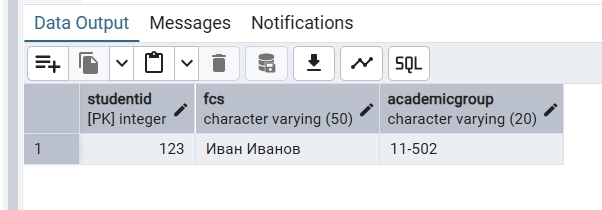

8. Выборка данных, логические операции

8. 1. Получить старших преподавателей кафедры программной инженерии
```sql
SELECT * FROM teacher WHERE Post = 'Старший преподаватель' AND DepartmentName = 'Кафедра программной инженерии';
```
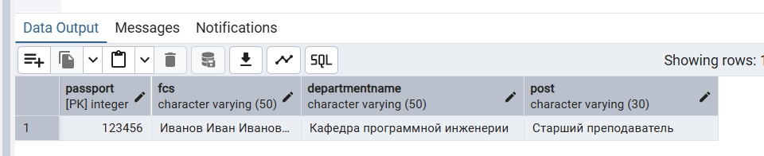

8. 2. Получить дисциплины, трудоёмкость которых больше 100 часов или форма аттестации которых — зачёт
```sql
SELECT * FROM discipline WHERE Intensity > 100 OR CertificationForm = 'Зачёт';
```
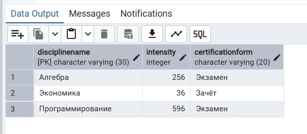

9. Выборка данных, операторы BETWEEN, IN

9. 1. Получить дисциплины с трудоёмкостью от 100 до 600 часов включительно
```sql
SELECT * FROM discipline WHERE Intensity BETWEEN 100 AND 600;
```
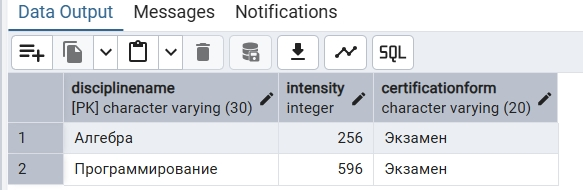

9. 2. Получить факультеты, относящиеся к МГУ или КФУ
```sql
SELECT * FROM faculty WHERE UniversityName IN ('МГУ', 'КФУ');
```
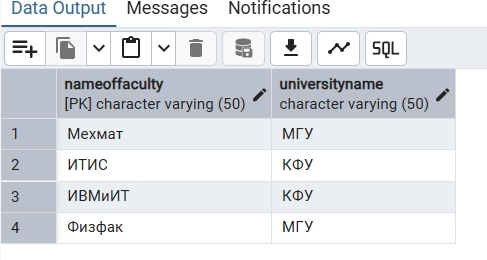

10. Выборка данных с сортировкой

10. 1. Получить студентов, отсортировав их по ФИО в алфавитном порядке
```sql
SELECT * FROM student ORDER BY FCs;
```
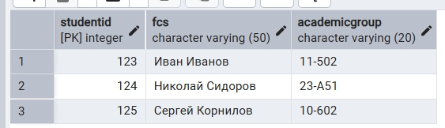

10. 2. Получить дисциплины, отсортировав их по убыванию трудоёмкости
```sql
SELECT * FROM discipline ORDER BY Intensity DESC;
```
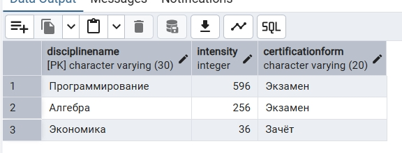

11. Выборка данных, оператор LIKE

11. 1. Получить преподавателей, ФИО которых начинается с буквы «И»
```sql
SELECT * FROM teacher WHERE FCs LIKE 'И%';
```
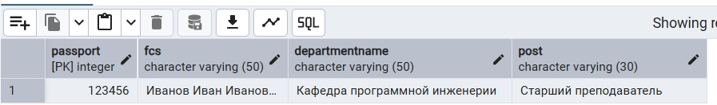

11. 2. Получить кафедры, в названии которых встречается слово «информатики»
```sql
SELECT * FROM department WHERE NameOfDepartment LIKE '%информатики%';
```
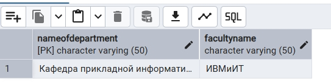

12. Выбор уникальных элементов столбца

12. 1. Получить список уникальных должностей преподавателей
```sql
SELECT DISTINCT Post FROM teacher;
```
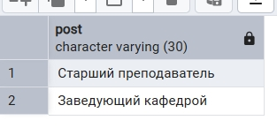

12. 2. Получить список уникальных форм аттестации по дисциплинам
```sql
SELECT DISTINCT CertificationForm FROM discipline;
```
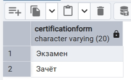

13. Выбор ограниченного кол-ва возвращаемых строк

13. 1. Получить первые две записи из таблицы студентов
```sql
SELECT * FROM student LIMIT 2;
```
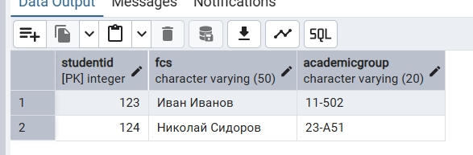

13. 2. Получить две дисциплины с наибольшей трудоёмкостью
```sql
SELECT * FROM discipline ORDER BY Intensity DESC LIMIT 2;
```
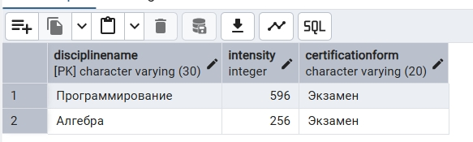

14. INNER JOIN

14. 1. Получить ФИО студентов, их группы, специальности и курсы
```sql
SELECT student.FCs,
       academic_group.NumberOfGroup,
       academic_group.SpecialityName,
       academic_group.Course
FROM student
INNER JOIN academic_group ON student.AcademicGroup = academic_group.NumberOfGroup;
```
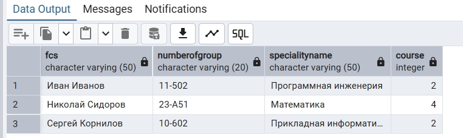

14. 2. Получить названия кафедр и факультетов, к которым они относятся
```sql
SELECT department.NameOfDepartment,
       faculty.NameOfFaculty
FROM department
INNER JOIN faculty ON department.FacultyName = faculty.NameOfFaculty;
```
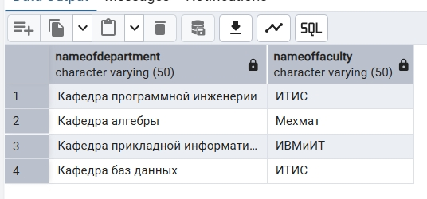

15. LEFT и RIGHT OUTER JOIN

15. 1. Получить все университеты и ФИО их ректоров, включая университеты, для которых ректор не указан
```sql
SELECT university.NameOfUniversity,
       rector.FCs
FROM university
LEFT OUTER JOIN rector
    ON university.NameOfUniversity = rector.UniversityName;
```
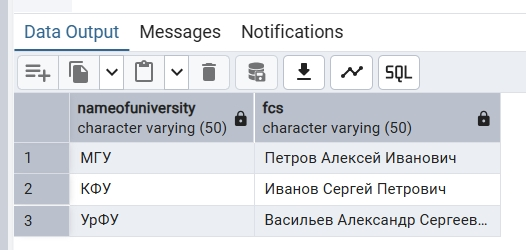

15. 2. Получить все специальности и связанные с ними учебные группы, включая специальности, для которых групп пока нет
```sql
SELECT speciality.NameOfSpeciality,
       academic_group.NumberOfGroup
FROM academic_group
RIGHT OUTER JOIN speciality
    ON academic_group.SpecialityName = speciality.NameOfSpeciality;
```
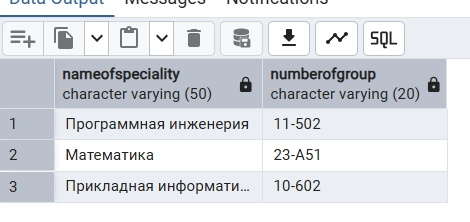

16. CROSS JOIN

16. 1. Получить все возможные пары «студент — дисциплина» и для каждой пары вывести, изучает ли студент эту дисциплину
```sql
SELECT student.FCs, discipline.DisciplineName,
    CASE
        WHEN student_discipline.StudentID IS NOT NULL THEN 'Изучает'
        ELSE 'Не изучает'
    END AS StudyStatus
FROM student CROSS JOIN discipline LEFT JOIN student_discipline
    ON student.StudentID = student_discipline.StudentID AND discipline.DisciplineName = student_discipline.DisciplineName;
```
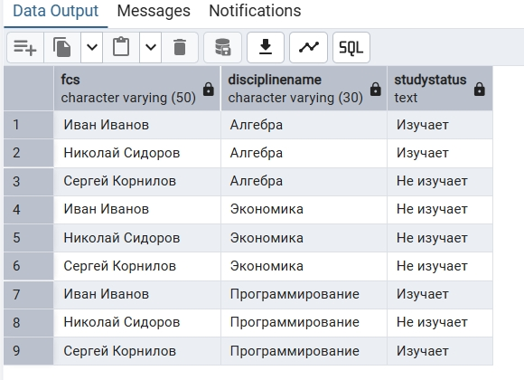

16. 2. Получить все возможные пары «университет — дисциплина»
```sql
SELECT university.NameOfUniversity,
       discipline.DisciplineName
FROM university
CROSS JOIN discipline;
```
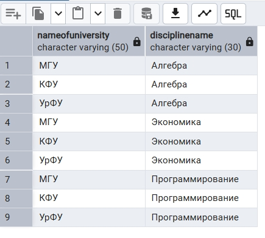

17. Выборка из нескольких таблиц

17. 1. Получить ФИО студентов, их группы, специальности, факультеты и университеты
```sql
SELECT student.FCs,
       academic_group.NumberOfGroup,
       speciality.NameOfSpeciality,
       faculty.NameOfFaculty,
       university.NameOfUniversity
FROM student
INNER JOIN academic_group
    ON student.AcademicGroup = academic_group.NumberOfGroup
INNER JOIN speciality
    ON academic_group.SpecialityName = speciality.NameOfSpeciality
INNER JOIN faculty
    ON speciality.FacultyName = faculty.NameOfFaculty
INNER JOIN university
    ON faculty.UniversityName = university.NameOfUniversity;
```
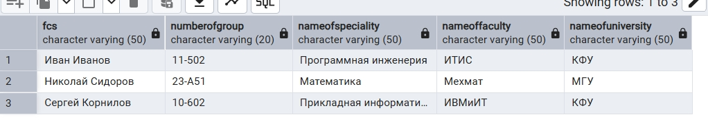

17. 2. Получить ФИО преподавателей, их кафедры, факультеты и университеты
```sql
SELECT teacher.FCs,
       department.NameOfDepartment,
       faculty.NameOfFaculty,
       university.NameOfUniversity
FROM teacher
INNER JOIN department
    ON teacher.DepartmentName = department.NameOfDepartment
INNER JOIN faculty
    ON department.FacultyName = faculty.NameOfFaculty
INNER JOIN university
    ON faculty.UniversityName = university.NameOfUniversity;
```
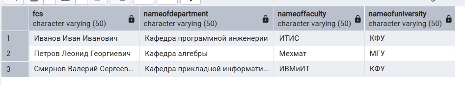