1. AVG

1. 1. Получить среднее количество академических часов, отводимых на дисциплину
```sql
SELECT AVG(intensity) AS average_intensity FROM discipline;
```
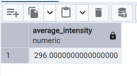

1. 2. Получить средний из номеров паспортов преподавателей
```sql
SELECT AVG(passport) AS average_passport FROM teacher;
```
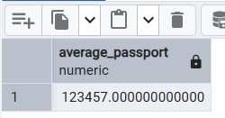

2. COUNT

2. 1. Посчитать число академических групп в БД
```sql
SELECT COUNT(*) FROM academic_group;
```
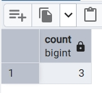

2. 2. Получить число факультетов, на которых есть хотя бы одна кафедра
```sql
SELECT COUNT(DISTINCT facultyname) FROM department;
```
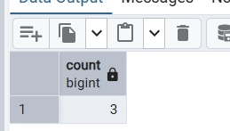

3. MIN и MAX

3. 1. Получить минимальное количество академических часов, отводимых на дисциплину
```sql
SELECT MIN(intensity) FROM discipline;
```
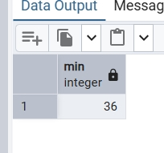

3. 2. Получить номер самого старшего курса среди всех групп в БД
```sql
SELECT MAX(course) FROM academic_group;
```
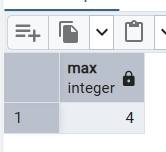

4. SUM

4. 1. Получить общее количество академических часов, отведённых на все дисциплины
```sql
SELECT SUM(intensity) FROM discipline;
```
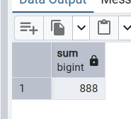

4. 2. Для каждого студента получить число, равное (курс * 1000 + номер студенческого) и найти сумму этих чисел для всех студентов
```sql
SELECT SUM(course * 1000 + studentid) FROM student INNER JOIN academic_group ON academic_group.numberofgroup = student.academicgroup;
```
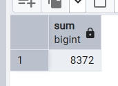

5. STRING_AGG

5. 1. Получить названия всех дисциплин через запятую
```sql
SELECT STRING_AGG(disciplinename, ', ') FROM discipline;
```
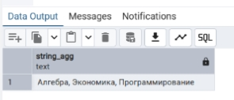

5. 2. Получить ФИО ректоров всех университетов через ;
```sql
SELECT STRING_AGG(FCs, '; ') FROM rector;
```
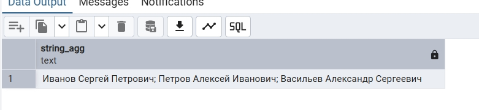

6. Комбинирование функций

6. 1. Получить число студентов, самый старший и самый младший курс, а также названия всех специальностей, на которых обучаются студенты
```sql
SELECT COUNT(*) AS students_count, MIN(course) AS min_course, MAX(course) AS max_course,
STRING_AGG(specialityname, ', ') FROM student INNER JOIN academic_group ON academic_group.numberofgroup = student.academicgroup;
```


6. 2. Получить число уникальных должностей преподавателей, их названия, а также средний из номеров паспортов преподавателей
```sql
SELECT COUNT(DISTINCT post) AS posts_count, AVG(passport) AS average_passport, STRING_AGG(post, ', ')FROM teacher;
```
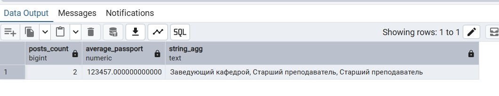

7. GROUP BY

7. 1. Получить ФИО преподавателей и их должности, сгруппировав по должностям
```sql
SELECT STRING_AGG(FCs, ', '), post FROM teacher GROUP BY post;
```
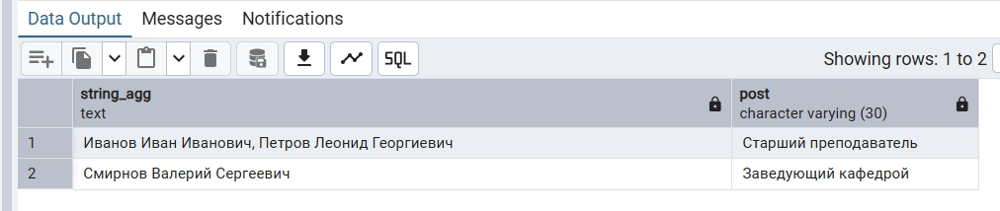

7. 2. Получить названия дисциплин, поставив их в соответствие с их формами аттестации
```sql
SELECT STRING_AGG(disciplinename, ', '), certificationform FROM discipline GROUP BY certificationform;
```
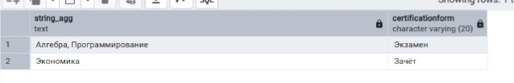

8. Фильтрация групп

8. 1. Получить все дисциплины, число академ часов которых больше 10, но меньше 500, сгруппировав по типу аттестации и числу академ часов
```sql
SELECT STRING_AGG(disciplinename, ', '), intensity, certificationform
FROM discipline GROUP BY certificationform, intensity HAVING (intensity > 10 AND intensity < 500);
```
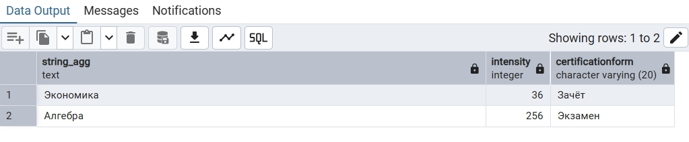

8. 2. Сопоставить специальности и курсы, по которым обучаются суденты курсов старше первого
```sql
SELECT STRING_AGG(specialityname, ', '), course FROM academic_group GROUP BY course HAVING (course > 1);
```
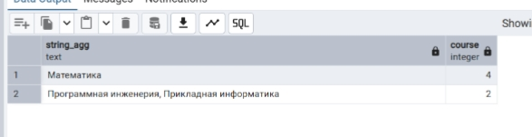

9. GROUPING SETS

9. 1. Посчитать количество преподавателей отдельно по кафедрам, отдельно по должностям и общее количество преподавателей
```sql
SELECT departmentname, post, COUNT(*) AS teacher_count
FROM teacher GROUP BY GROUPING SETS ((departmentname), (post), ());
```
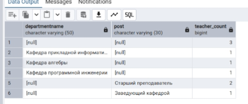

9. 2. Посчитать количество групп по специальностям, формам обучения и общее их количество
```sql
SELECT specialityname, formofstudy, COUNT(*) AS group_count
FROM academic_group GROUP BY GROUPING SETS ((specialityname), (formofstudy), ());
```
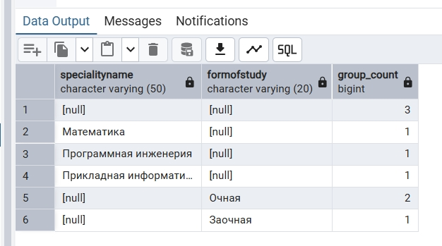

10. ROLLUP

10. 1. Посчитать количество студентов по группам и получить общее количество студентов
```sql
SELECT academicgroup, COUNT(*) AS student_count FROM student GROUP BY ROLLUP (academicgroup);
```
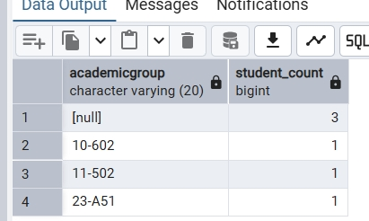

10. 2. Посчитать количество преподавателей по каждой должности внутри каждой кафедры
```sql
SELECT departmentname, post, COUNT(*) AS teacher_count FROM teacher GROUP BY ROLLUP (departmentname, post);
```
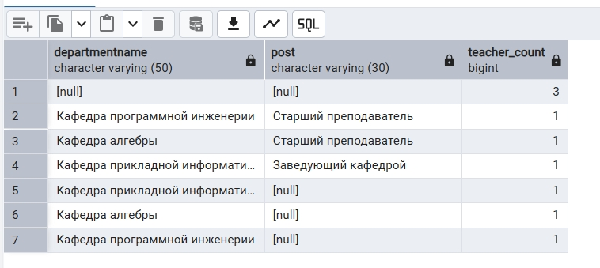

11. CUBE

11. 1. Посчитать количество кафедр по факультетам и университетам
```sql
SELECT faculty.nameoffaculty, faculty.universityname, COUNT(department.nameofdepartment) AS department_count
FROM faculty LEFT JOIN department ON faculty.nameoffaculty = department.facultyname GROUP BY CUBE (faculty.nameoffaculty, faculty.universityname);
```
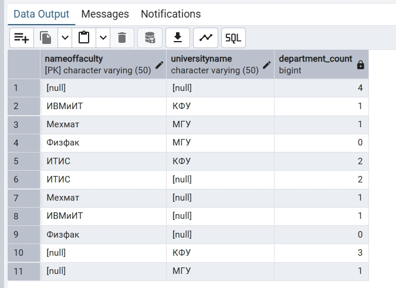

11. 2. Посчитать количество дисциплин по форме аттестации и числу академ часов
```sql
SELECT certificationform, intensity, COUNT(*) AS discipline_count FROM discipline GROUP BY CUBE (certificationform, intensity);
```
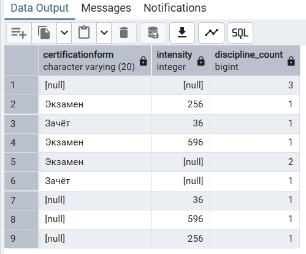