1. CTE

1.1. Получить список групп и количество студентов в каждой группе
```sql
WITH group_students AS (SELECT * FROM academic_group JOIN student ON academic_group.numberOfGroup = student.academicGroup)
SELECT numberOfGroup, COUNT(studentID) AS countOfStudents, STRING_AGG(FCs, ', ') AS students
FROM group_students GROUP BY numberOfGroup;
```
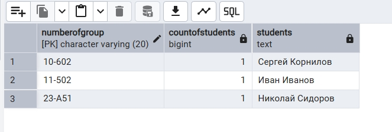

1.2. Получить названия факультетов и количество кафедр на каждом факультете
```sql
WITH faculty_departments AS (SELECT f.nameOfFaculty, COUNT(d.nameOfDepartment) AS departmentCount,
STRING_AGG(d.nameOfDepartment, ', ') AS departments FROM faculty AS f LEFT JOIN department AS d
ON f.nameOfFaculty = d.facultyName GROUP BY f.nameOfFaculty)
SELECT nameOfFaculty, departmentCount, departments FROM faculty_departments;
```
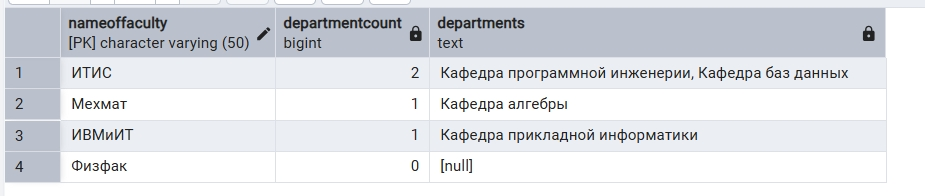

1.3. Получить дисциплины, трудоёмкость которых выше средней трудоёмкости всех дисциплин
```sql
WITH average_intensity AS (SELECT AVG(intensity) AS averageIntensity FROM discipline)
SELECT disciplineName, intensity FROM discipline, average_intensity WHERE intensity > averageIntensity;
```
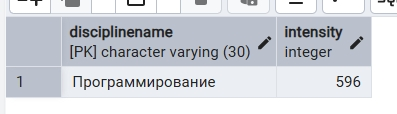

2. UNION

2.1. Получить единый список ФИО студентов и преподавателей
```sql
SELECT FCs FROM student
UNION ALL
SELECT fCs FROM teacher;
```
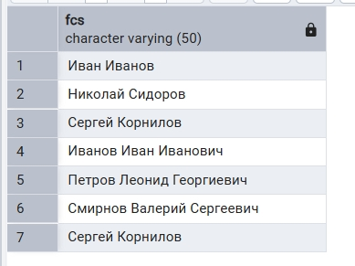

3. INTERSECT

3.1. Получить ФИО студентов, у которых есть полный тёзка среди преподавателей
```sql
SELECT FCs FROM student
INTERSECT
SELECT fCs FROM teacher;
```


4. EXCEPT

4.1. Получить ФИО студентов, у которых нет полного тёзки среди преподавателей
```sql
SELECT FCs FROM student
EXCEPT
SELECT fCs FROM teacher;
```
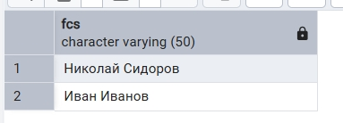

5. PARTITION BY

5.1. Получить студентов и количество студентов в группе каждого из них
```sql
SELECT FCs, academicGroup, COUNT(*) OVER (PARTITION BY academicGroup) AS studentsInGroup FROM student;
```
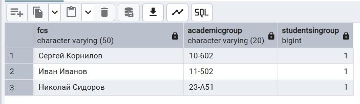

5.2. Получить преподавателей и количество преподавателей на кафедре каждого
```sql
SELECT FCs, departmentName, COUNT(*) OVER (PARTITION BY departmentName) AS teachersInDepartment FROM teacher;
```
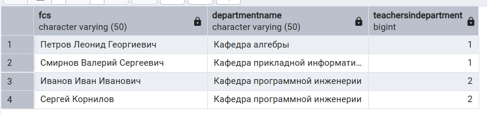

6. PARTITION BY + ORDER BY

6.1. Для каждой кафедры вывести факультет и список кафедр этого факультета в алфавитном порядке
```sql
SELECT nameOfDepartment, facultyName, STRING_AGG(nameOfDepartment, ', ') OVER (PARTITION BY facultyName ORDER BY nameOfDepartment) AS departments FROM department;
```
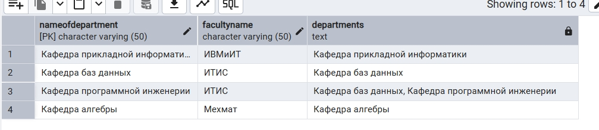

6.2. Для каждого преподавателя вывести кафедру и список преподавателей этой кафедры в алфавитном порядке
```sql
SELECT FCs, departmentName, STRING_AGG(fCs, ', ') OVER (PARTITION BY departmentName ORDER BY FCs) AS teachers FROM teacher;
```
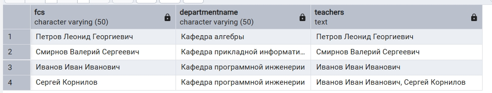

7. ROWS

7.1. Для каждой дисциплины вывести её трудоёмкость и сумму трудоёмкости текущей и предыдущей дисциплины при сортировке по трудоёмкости
```sql
SELECT disciplineName, intensity, SUM(intensity) OVER (ORDER BY intensity ROWS BETWEEN 1 PRECEDING AND CURRENT ROW) AS intensitySum FROM discipline;
```
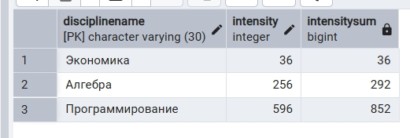

7.2. Для каждой группы вывести курс и средний курс текущей, предыдущей и следующей группы
```sql
SELECT numberOfGroup, course, AVG(course) OVER (ORDER BY numberOfGroup ROWS BETWEEN 1 PRECEDING AND 1 FOLLOWING) AS averageCourse FROM academic_group;
```
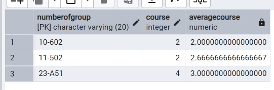

8. RANGE

8.1. Для каждой дисциплины вывести её трудоёмкость и среднюю трудоёмкость дисциплин, отличающихся от неё не более чем на 300 часов
```sql
SELECT disciplineName, intensity, AVG(intensity) OVER (ORDER BY intensity RANGE BETWEEN 300 PRECEDING AND 300 FOLLOWING) AS averageIntensity FROM discipline;
```
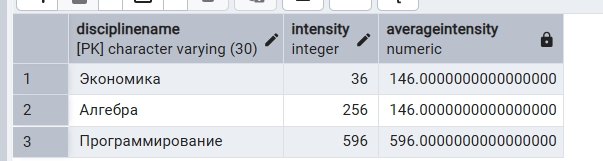

8.2. Для каждой учебной группы вывести курс и количество групп, находящихся на том же или соседнем курсе
```sql
SELECT numberOfGroup, course, COUNT(*) OVER (ORDER BY course RANGE BETWEEN 1 PRECEDING AND 1 FOLLOWING) AS groupsCount FROM academic_group;
```
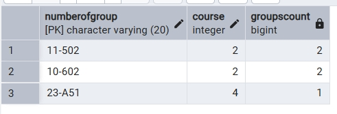

9. Ранжирующие функции

9.1. Пронумеровать преподавателей внутри каждой кафедры по ФИО
```sql
SELECT passport, FCs, departmentName, ROW_NUMBER() OVER (PARTITION BY departmentName ORDER BY fCs) AS teacherNumber FROM teacher;
```
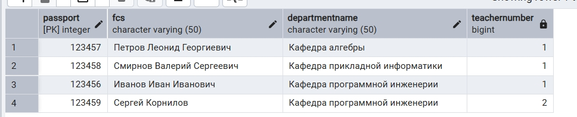

9.2. Определить место дисциплины по трудоёмкости
```sql
SELECT disciplineName, intensity, RANK() OVER (ORDER BY intensity DESC) AS intensityRank FROM discipline;
```
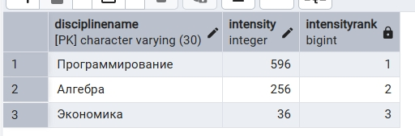

9.3. Определить место группы по курсу
```sql
SELECT numberOfGroup, course, DENSE_RANK() OVER (ORDER BY course DESC) AS courseRank FROM academic_group;
```
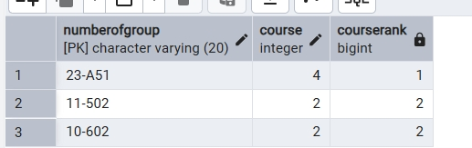

10. Функции смещения

10.1. Для каждой дисциплины вывести трудоёмкость предыдущей дисциплины при сортировке по трудоёмкости
```sql
SELECT disciplineName, intensity, LAG(intensity) OVER (ORDER BY intensity) AS previousIntensity FROM discipline;
```
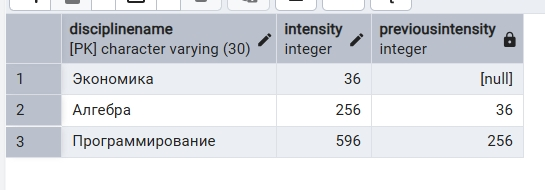

10.2. Для каждой дисциплины вывести трудоёмкость следующей дисциплины
```sql
SELECT disciplineName, intensity, LEAD(intensity) OVER (ORDER BY intensity) AS nextIntensity FROM discipline;
```
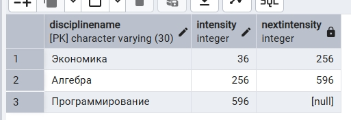

10.3. Для каждого преподавателя вывести первого по алфавиту преподавателя его кафедры
```sql
SELECT FCs, departmentName, FIRST_VALUE(FCs) OVER (PARTITION BY departmentName ORDER BY FCs) AS firstTeacher FROM teacher;
```
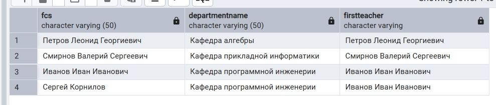

10.4. Для каждого преподавателя вывести последнего по алфавиту преподавателя его кафедры
```sql
SELECT FCs, departmentName, LAST_VALUE(FCs) OVER (PARTITION BY departmentName ORDER BY FCs
ROWS BETWEEN UNBOUNDED PRECEDING AND UNBOUNDED FOLLOWING) AS lastTeacher FROM teacher;
```
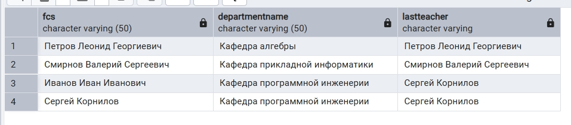