1. SELECT

1.1. Получить название и трудоёмкость каждой дисциплины, а также среднюю трудоёмкость всех дисциплин
```sql
SELECT disciplineName, intensity, (SELECT AVG(intensity) FROM discipline) AS averageIntensity FROM discipline;
```
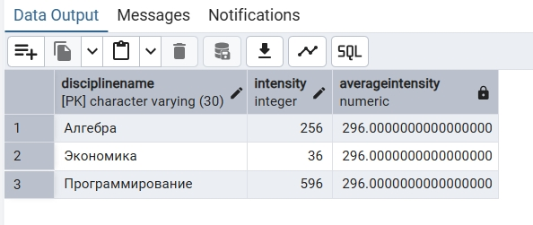

1.2. Получить ФИО и группу каждого студента, а также общее количество студентов в базе
```sql
SELECT FCs, academicGroup, (SELECT COUNT(*) FROM student) AS totalStudents FROM student;
```
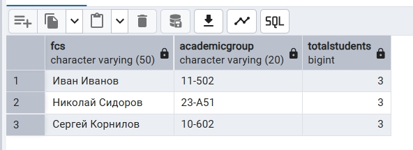

2. FROM

2.1. Получить группы и количество студентов в каждой группе
```sql
SELECT academicGroup, studentCount FROM (SELECT academicGroup, COUNT(*)
AS studentCount FROM student GROUP BY academicGroup) AS groupStats;
```
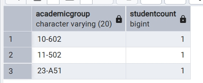

2.2. Получить специальности и средний курс групп по каждой специальности
```sql
SELECT specialityName, averageCourse FROM (SELECT specialityName, AVG(course)
AS averageCourse FROM academic_group GROUP BY specialityName) AS specialityStats;
```
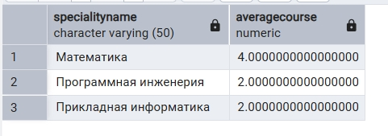

3. WHERE

3.1. Получить преподавателей с самым длинным названием должности
```sql
SELECT * FROM teacher WHERE LENGTH(post) = (SELECT MAX(LENGTH(post)) FROM teacher);
```
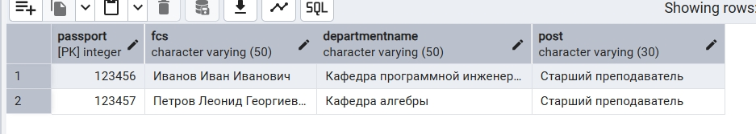

3.2. Получить дисциплины с самой низкой трудоёмкостью
```sql
SELECT * FROM discipline WHERE intensity = (SELECT MIN(intensity) FROM discipline);
```
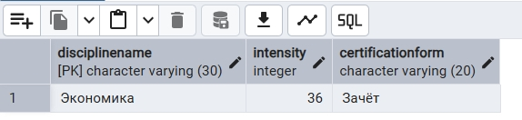

4. HAVING

4.1. Получить номера и курсы групп, у которых курс выше среднего по всем группам
```sql
SELECT numberOfGroup, course AS avg_course FROM academic_group GROUP BY numberOfGroup, course HAVING course > (SELECT AVG(course) FROM academic_group);
```
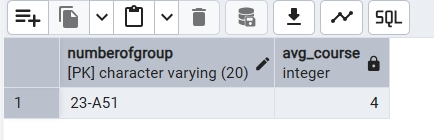

4.2. Получить факультеты, в которых количество кафедр больше среднего количества кафедр на факультет
```sql
SELECT facultyName FROM department GROUP BY facultyName HAVING COUNT(*) > (SELECT AVG(departmentCount)
FROM (SELECT COUNT(*) AS departmentCount FROM department GROUP BY facultyName));
```


5. ALL

5.1. Получить дисциплины, трудоёмкость которых больше трудоёмкости всех дисциплин с зачётом
```sql
SELECT * FROM discipline WHERE intensity > ALL(SELECT intensity FROM discipline WHERE certificationForm = 'Зачёт');
```
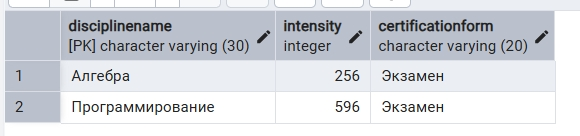

5.2. Получить группы, курс которых больше курса всех групп с заочной формой обучения
```sql
SELECT * FROM academic_group WHERE course > ALL(SELECT course from academic_group WHERE formOfStudy = 'Заочная');
```
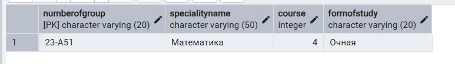

6. IN

6.1. Получить всех преподавателей, которые работают на кафедрах ИТИС
```sql
SELECT t.FCS, t.departmentName, d.facultyName FROM teacher AS t JOIN department AS d ON t.departmentName = d.nameOfDepartment
WHERE t.departmentName IN (SELECT nameOfDepartment FROM department WHERE facultyName = 'ИТИС');
```
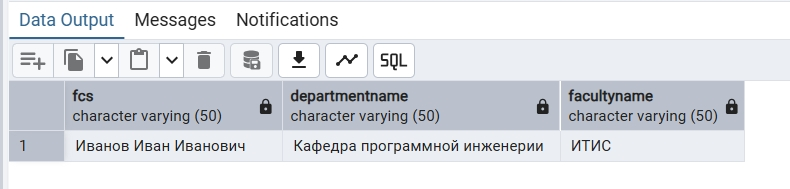

6.2. Получить всех второкурсников
```sql
SELECT s.FCs, s.academicGroup, g.course FROM student AS s JOIN academic_group AS g ON s.academicGroup = g.numberOfGroup
WHERE s.academicGroup IN (SELECT numberOfGroup FROM academic_group WHERE course = 2);
```
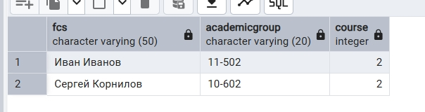

7. ANY

7.1. Получить дисциплины, трудоёмкость которых больше трудоёмкости хотя бы одной дисциплины с зачётом
```sql
SELECT * FROM discipline WHERE intensity > ANY(SELECT intensity FROM discipline WHERE certificationForm = 'Зачёт');
```
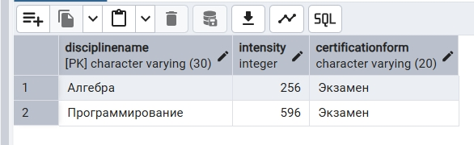

7.2. Получить группы, курс которых выше курса хотя бы одной группы с заочной формой обучения
```sql
SELECT * FROM academic_group WHERE course > ANY(SELECT course from academic_group WHERE formOfStudy = 'Заочная');
```
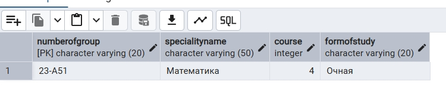

8. EXIST

8.1. 
```sql
SELECT s.studentId, s.FCs, s.academicGroup FROM student AS s
WHERE EXISTS (SELECT 1 FROM student_discipline AS sd WHERE sd.studentId = s.studentId);
```
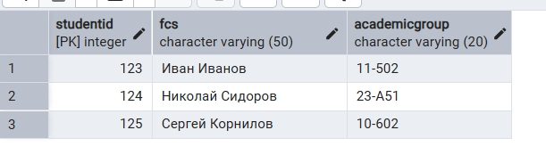

8.2. Получить факультеты, на которых нет ни одной кафедры
```sql
SELECT f.nameOfFaculty FROM faculty AS f
WHERE NOT EXISTS (SELECT 1 FROM department AS d WHERE f.nameOfFaculty = d.facultyName);
```
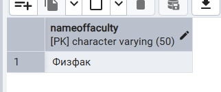

9. Сравнение по нескольким столбцам

9.1. Получить группы, у которых курс и форма обучения совпадают с курсом и формой обучения группы 11-502
```sql
SELECT numberOfGroup, specialityName, course, formOfStudy FROM academic_group
WHERE (course, formOfStudy) = (SELECT course, formOfStudy FROM academic_group WHERE numberOfGroup = '11-502');
```
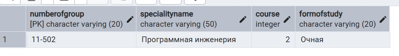

9.2. Получить дисциплины, у которых сочетание трудоёмкости и формы аттестации совпадает хотя бы с одной дисциплиной трудоёмкостью более 100 часов
```sql
SELECT disciplineName, intensity, certificationForm FROM discipline
WHERE (intensity, certificationForm) IN (SELECT intensity, certificationForm FROM discipline WHERE intensity > 100);
```
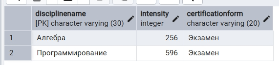

10. Коррелированные подзапросы

10.1. Получить студентов, которые изучают хотя бы одну дисциплину с экзаменом
```sql
SELECT s.studentId, s.FCs, s.academicGroup FROM student AS s
WHERE EXISTS (SELECT 1 FROM student_discipline AS sd JOIN discipline AS d ON sd.disciplineName = d.disciplineName
WHERE sd.studentId = s.studentId AND d.certificationForm = 'Экзамен');
```
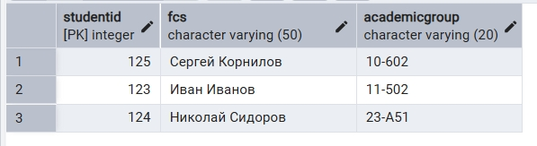

10.2. Получить преподавателей, которые работают на кафедрах КФУ
```sql
SELECT t.passport, t.FCs, t.departmentName FROM teacher AS t
WHERE EXISTS (SELECT 1 FROM department AS d JOIN faculty AS f ON d.facultyName = f.nameOfFaculty
WHERE d.nameOfDepartment = t.departmentName AND f.universityName = 'КФУ');
```
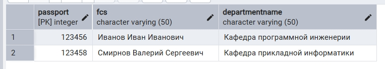

10.3. Получить дисциплины и количество студентов, которые их изучают
```sql
SELECT d.disciplineName, (SELECT COUNT(*) FROM student_discipline AS sd
WHERE sd.disciplineName = d.disciplineName) AS studentCount FROM discipline AS d;
```
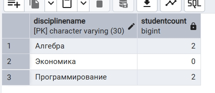

10.4. Получить факультеты, у которых есть хотя бы одна кафедра
```sql
SELECT f.nameOfFaculty, f.universityName FROM faculty AS f WHERE EXISTS (SELECT 1
FROM department AS d WHERE d.facultyName = f.nameOfFaculty);
```
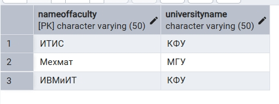

10.5. Получить группы, в которых учится по 1 студенту
```sql
SELECT g.numberOfGroup, g.specialityName FROM academic_group AS g
WHERE (SELECT COUNT(*) FROM student AS s WHERE s.academicGroup = g.numberOfGroup) = 1;
```
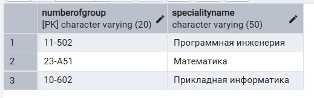