1. BEGIN ... COMMIT

1.1. Добавление нового студента и изменение формы обучения его группы
```sql
BEGIN;
INSERT INTO student (studentId, FCs, academicGroup) VALUES (126, 'Алексей Петров', '11-502');
UPDATE academic_group SET formOfStudy = 'Очно-заочная' WHERE numberOfGroup = '11-502';
COMMIT;
```
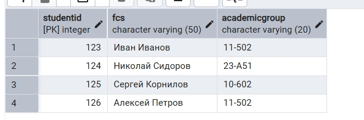
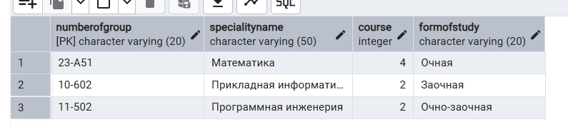

1.2. Добавление нового преподавателя и изменение факультета его кафедры
```sql
BEGIN;
INSERT INTO teacher (passport, FCs, departmentName, post)VALUES (123469, 'Соколов Андрей Викторович', 'Кафедра баз данных', 'Доцент');
UPDATE department SET facultyName = 'ИВМиИТ' WHERE nameOfDepartment = 'Кафедра баз данных';
COMMIT;
```
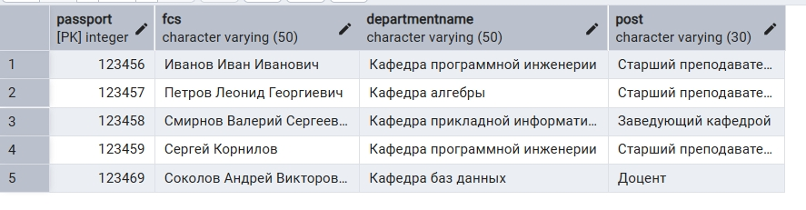
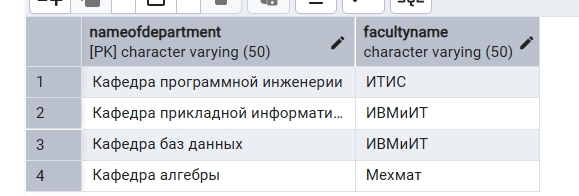

2. BEGIN ... ROLLBACK

2.1. Добавление нового студента и изменение формы обучения его группы с ROLLBACK
```sql
BEGIN;
INSERT INTO student (studentId, FCs, academicGroup) VALUES (127, 'Александр Иванов', '11-502');
UPDATE academic_group SET formOfStudy = 'Заочная' WHERE numberOfGroup = '11-502';
ROLLBACK;
```
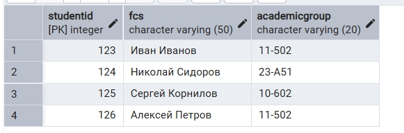
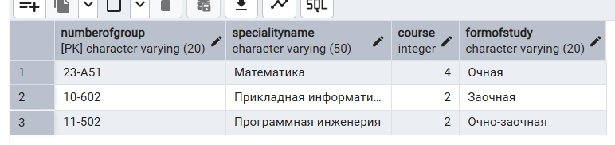

2.2. Добавление нового преподавателя и изменение факультета его кафедры с ROLLBACK
```sql
BEGIN;
INSERT INTO teacher (passport, FCs, departmentName, post)VALUES (123654, 'Соколов Андрей Викторович', 'Кафедра баз данных', 'Доцент');
UPDATE department SET facultyName = 'ИВМиИТ' WHERE nameOfDepartment = 'Кафедра баз данных';
ROLLBACK;
```
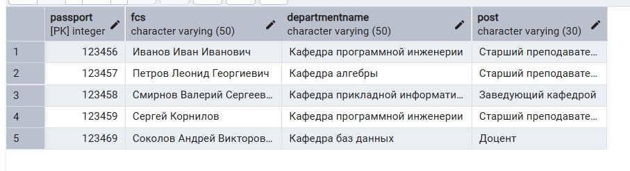
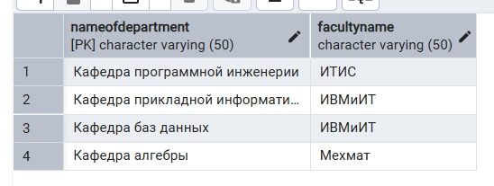

3. Транзакция с ошибкой

3.1. Поменять курс группы на недопустимый
```sql
BEGIN;
INSERT INTO student (studentId, FCs, academicGroup) VALUES (900001, 'Тестовый Студент', '11-502');
UPDATE academic_group SET course = 5 WHERE numberOfGroup = '11-502';
```
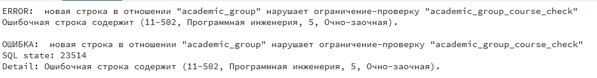
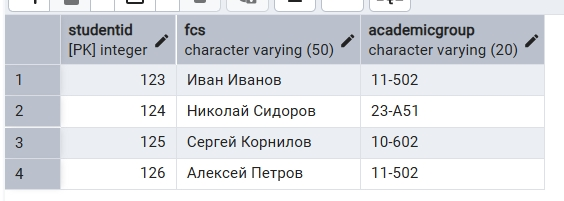

3.2. Получить названия дисциплин и формы аттестации на русском
```sql
BEGIN;
INSERT INTO discipline (disciplineName, intensity, certificationForm) VALUES ('Тестовая дисциплина', 100, 'Зачёт');
UPDATE discipline SET intensity = intensity / 0 WHERE disciplineName = 'Тестовая дисциплина';
```
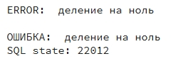
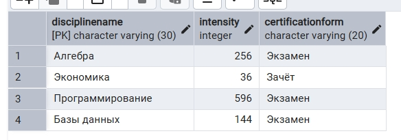

4. Грязное чтение

4.1. Запустил 2 транзакцию до завершения 1 на таблице discipline
```sql
BEGIN;
UPDATE discipline SET intensity = 999 WHERE disciplineName = 'Алгебра';
```
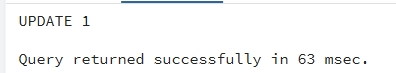

```sql
BEGIN TRANSACTION ISOLATION LEVEL READ UNCOMMITTED;
SELECT disciplineName, intensity FROM discipline WHERE disciplineName = 'Алгебра';
```
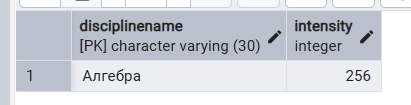

4.2. Запустил 2 транзакцию до завершения 1 на таблице teacher
```sql
BEGIN;
UPDATE teacher SET post = 'Профессор' WHERE passport = 123456;
```
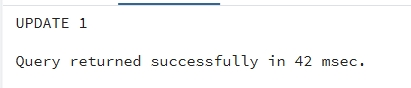

```sql
BEGIN TRANSACTION ISOLATION LEVEL READ UNCOMMITTED;
SELECT passport, FCs, post FROM teacher WHERE passport = 123456;
```
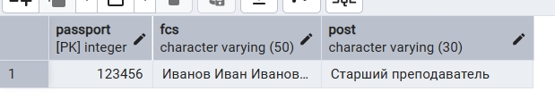

5. UPDATE без COMMIT в T1 и чтение в T2

5.1. Запустил 2 транзакцию до завершения 1 на таблице teacher, теперь уровень изоляции READ COMMITTED
```sql
BEGIN;
UPDATE teacher SET post = 'Профессор' WHERE passport = 123456;
```
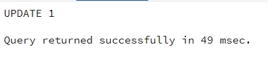

```sql
BEGIN;
SELECT passport, FCs, post FROM teacher WHERE passport = 123456;
```
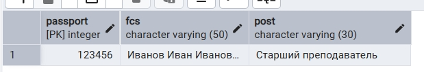

5.2. Запустил 2 транзакцию до завершения 1 на таблице discipline, теперь уровень изоляции READ COMMITTED
```sql
BEGIN;
UPDATE discipline SET intensity = 999 WHERE disciplineName = 'Алгебра';
```
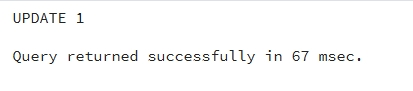

```sql
BEGIN;
SELECT disciplineName, intensity FROM discipline WHERE disciplineName = 'Алгебра';
```
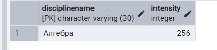

6. READ COMMITTED

6.1. На таблице teacher
```sql
BEGIN;
SELECT passport, FCs, post FROM teacher WHERE passport = 123456;
```
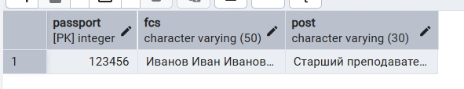

Это выполняется во 2 транзакции
```sql
BEGIN;
UPDATE teacher SET post = 'Профессор' WHERE passport = 123456;
COMMIT;
```
Это снова в 1 после завершения 2 транзакции
```sql
SELECT passport, FCs, post FROM teacher WHERE passport = 123456;
```
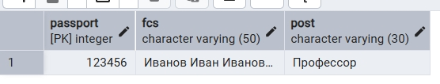

6.2. На таблице discipline
```sql
BEGIN;
SELECT disciplineName, intensity FROM discipline WHERE disciplineName = 'Алгебра';
```
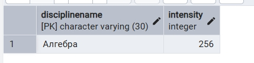

Это выполняется во 2 транзакции
```sql
BEGIN;
UPDATE discipline SET intensity = 300 WHERE disciplineName = 'Алгебра';
COMMIT;
```
Это снова в 1 после завершения 2 транзакции
```sql
SELECT disciplineName, intensity FROM discipline WHERE disciplineName = 'Алгебра';
```
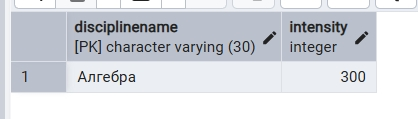

7. T1 не видит изменений от T2, пока не завершится

7.1. На таблице discipline
```sql
BEGIN TRANSACTION ISOLATION LEVEL REPEATABLE READ;
SELECT disciplineName, intensity FROM discipline WHERE disciplineName = 'Алгебра';
```
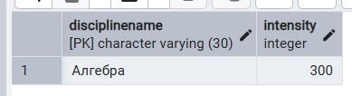

Это выполняется во 2 транзакции
```sql
BEGIN;
UPDATE discipline SET intensity = 500 WHERE disciplineName = 'Алгебра';
COMMIT;
```
Это снова в 1 после завершения 2 транзакции
```sql
SELECT disciplineName, intensity FROM discipline WHERE disciplineName = 'Алгебра';
```

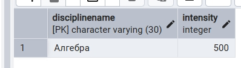

7.2. На таблице teacher
```sql
BEGIN TRANSACTION ISOLATION LEVEL REPEATABLE READ;
SELECT passport, FCs, post FROM teacher WHERE passport = 123456;
```
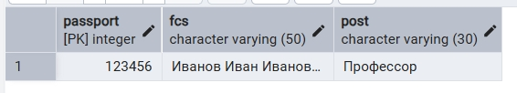

Это выполняется во 2 транзакции
```sql
BEGIN;
UPDATE teacher SET post = 'Старший преподаватель' WHERE passport = 123456;
COMMIT;
```
Это снова в 1 после завершения 2 транзакции
```sql
SELECT passport, FCs, post FROM teacher WHERE passport = 123456;
```

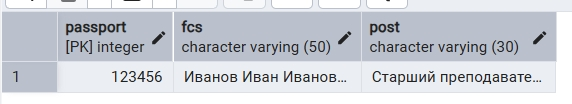

8. Фантомное чтение через INSERT (невозможно при REPEATABLE READ?)

8.1. На таблице teacher
```sql
BEGIN TRANSACTION ISOLATION LEVEL REPEATABLE READ;
SELECT passport, FCs, departmentName, post FROM teacher WHERE departmentName = 'Кафедра алгебры';
```
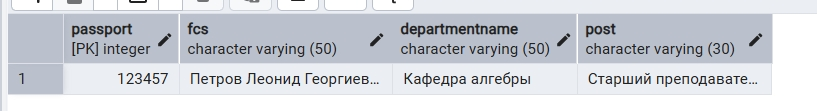

Это выполняется во 2 транзакции
```sql
BEGIN;
INSERT INTO teacher (passport, FCs, departmentName, post) VALUES (123460, 'Сидоров Алексей Петрович', 'Кафедра алгебры', 'Доцент');
COMMIT;
```
Это снова в 1 после завершения 2 транзакции
```sql
SELECT passport, FCs, departmentName, post FROM teacher WHERE departmentName = 'Кафедра алгебры';
```

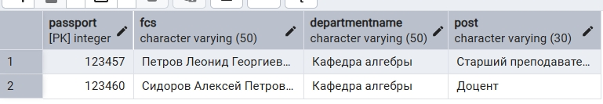

8.2. На таблице student
```sql
BEGIN TRANSACTION ISOLATION LEVEL REPEATABLE READ;
SELECT studentId, FCs, academicGroup FROM student WHERE academicGroup = '11-502';
```
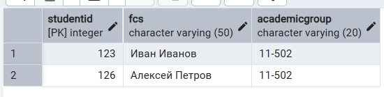

Это выполняется во 2 транзакции
```sql
BEGIN;
INSERT INTO student (studentId, FCs, academicGroup) VALUES (136, 'Алексей Смирнов', '11-502');
COMMIT;
```
Это снова в 1 после завершения 2 транзакции
```sql
SELECT studentId, FCs, academicGroup FROM student WHERE academicGroup = '11-502';
```

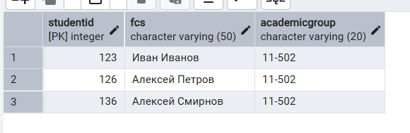

9. Две транзакции вставляют одинаковые данные

9.1. На таблице teacher
```sql
BEGIN TRANSACTION ISOLATION LEVEL SERIALIZABLE;
INSERT INTO teacher (passport, FCs, departmentName, post) VALUES (777777, 'Тестовый Преподаватель', 'Кафедра алгебры', 'Доцент');
```

То же самое выполняется во 2 транзакции
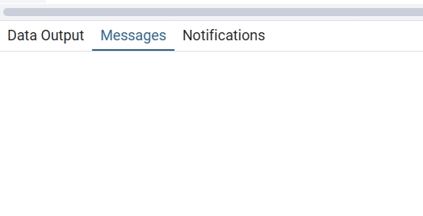
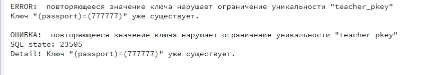

9.2. На таблице student
```sql
BEGIN TRANSACTION ISOLATION LEVEL SERIALIZABLE;
INSERT INTO student (studentId, FCs, academicGroup) VALUES (999, 'Тестовый Студент', '11-502');
```

То же самое выполняется во 2 транзакции

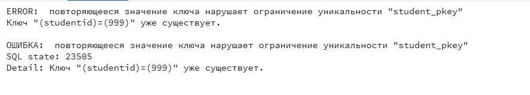


10. could not serialize access due to concurrent update

10.1. На таблице teacher
```sql
BEGIN TRANSACTION ISOLATION LEVEL SERIALIZABLE;
UPDATE teacher SET post = 'Доцент' WHERE passport = 123456;
```

Во 2 транзакции выполняется то же самое, но со значением Профессор

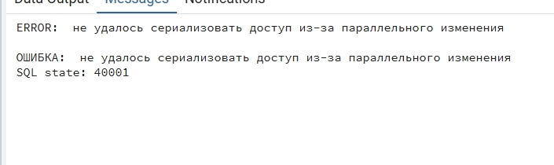

```sql
BEGIN TRANSACTION ISOLATION LEVEL SERIALIZABLE;
UPDATE teacher SET post = 'Профессор' WHERE passport = 123456;
COMMIT;
```
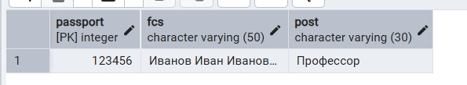

10.1. На таблице discipline
```sql
BEGIN TRANSACTION ISOLATION LEVEL SERIALIZABLE;
SELECT disciplineName, intensity FROM discipline WHERE disciplineName = 'Алгебра';
UPDATE discipline SET intensity = 300 WHERE disciplineName = 'Алгебра';
```

Во 2 транзакции выполняется то же самое, но со значением 400

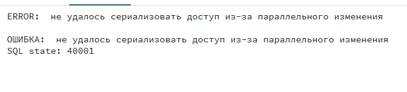

```sql
BEGIN TRANSACTION ISOLATION LEVEL SERIALIZABLE;
SELECT disciplineName, intensity FROM discipline WHERE disciplineName = 'Алгебра';
UPDATE discipline SET intensity = 400 WHERE disciplineName = 'Алгебра';
COMMIT;
```
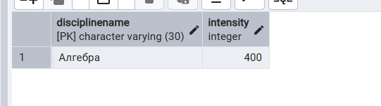
11. SAVEPOINT

11.1. Изменить трудоёмкость дисциплины, создать точку сохранения, затем изменить форму аттестации. Откатиться к точке сохранения
```sql
BEGIN;
UPDATE discipline SET intensity = 150 WHERE disciplineName = 'Экономика';

SAVEPOINT sp1;

UPDATE discipline SET certificationForm = 'Экзамен' WHERE disciplineName = 'Экономика';

ROLLBACK TO SAVEPOINT sp1;

SELECT disciplineName, intensity, certificationForm FROM discipline WHERE disciplineName = 'Экономика';
COMMIT;
```
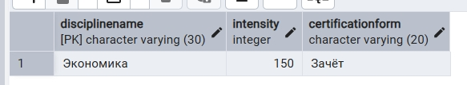

11.2. Несколько раз изменить должность преподавателя, создавая точки сохранения. Сначала вернуться ко второй точке, затем к первой
```sql
BEGIN;
UPDATE teacher SET post = 'Доцент' WHERE passport = 123456;

SAVEPOINT sp1;

UPDATE teacher SET post = 'Профессор' WHERE passport = 123456;

SAVEPOINT sp2;

UPDATE teacher SET post = 'Заведующий кафедрой' WHERE passport = 123456;
```

Затем возвращаемся ко 2 точке
```sql
ROLLBACK TO SAVEPOINT sp2;

SELECT passport, FCs, post FROM teacher WHERE passport = 123456;
```
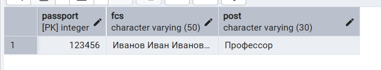

Теперь возвращаемся к 1
```sql
ROLLBACK TO SAVEPOINT sp1;

SELECT passport, FCs, post FROM teacher WHERE passport = 123456;
```
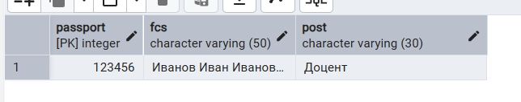
